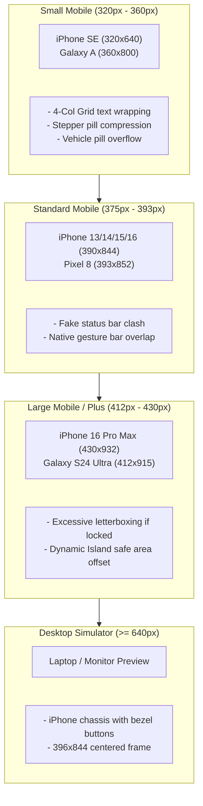

# VoltIndia UI & Mobile Responsiveness Comprehensive Audit & Fix Report

> **Target File:** [`c:\triaproject\ev\app1.1.html`](file:///c:/triaproject/ev/app1.1.html) & [`c:\triaproject\ev\index.html`](file:///c:/triaproject/ev/index.html)  
> **Platform Target:** Native Mobile Web Application (iOS Safari, Android Chrome, Standalone PWA, and Desktop Simulator)  
> **Date:** November 20, 2026  
> **Status:** Critical Audit & Remediation Guide

---

## 1. Executive Summary

VoltIndia is a high-fidelity mobile prototype for doorstep on-demand DC fast charging, roadside rescue (12V jump-starts, flatbed towing), and EV lifestyle management tailored to Kochi, Kerala (featuring Tata Nexon EV with Kerala HSRP registration `KL 07 CD 1234`).

While the application features visually rich UI components (such as interactive vector maps, frosted glassmorphism, and 3D service cards), **the underlying container was originally designed as a desktop-centric iPhone frame simulator rather than a production-ready mobile web app**. When opened on physical smartphones (such as real iPhones or Android devices), the interface exhibits critical real-device rendering conflicts, notably:
1. **Double Status Bars:** A hardcoded, static status bar (fixed clock `9:41`, fake 100% battery, fake Wi-Fi/cellular icons) displays directly beneath or overlapping the phone's native operating system status bar.
2. **Double Home Indicators:** A static black bar (`w-[134px] h-[5px]`) sits above the device's native OS gesture navigation bar, stealing vertical real estate and disrupting gesture navigation.
3. **Zero Safe-Area Inset Handling:** The codebase completely lacks `env(safe-area-inset-top)` and `env(safe-area-inset-bottom)`, relying instead on brittle hardcoded pixel paddings (`pt-[54px]`, `pt-[58px]`).
4. **Viewport Meta Restrictions:** The viewport meta tag omits `viewport-fit=cover`, causing iOS Safari to letterbox content.
5. **Horizontal Squeezing on 320px–360px Screens:** Key component rows (such as the 4-column service grid, 3-step checkout steppers, and multi-pill active vehicle headers) risk text wrapping and icon clipping on narrow screens.

This report delivers a thorough architectural and visual analysis across screen sizes (320px to 430px mobile, tablets, and desktop) and provides concrete, copy-pasteable code fixes for every defect identified.

---

## 2. Critical Defect Analysis: Simulator Artifacts on Real Devices

### Defect 2.1: The Fake Status Bar (`#ios-status-bar`)

#### Code Location:
Lines 984–1014 in `app1.1.html`:
```html
<!-- Status Bar -->
<div id="ios-status-bar"
  class="absolute top-0 inset-x-0 h-[44px] sm:h-[50px] px-6 sm:px-7 pt-2 sm:pt-2.5 flex items-center justify-between text-[13px] font-display font-bold select-none z-30 text-label sb-glass">
  <span class="w-12">9:41</span>
  <div class="hidden sm:flex w-[112px] h-[30px] bg-black rounded-full items-center justify-between px-3">
    <span class="w-1.5 h-1.5 rounded-full bg-teal animate-pulse"></span>
    <div class="w-2.5 h-2.5 rounded-full bg-[#1a1a22] border border-[#2c2c36]"></div>
  </div>
  <div class="flex items-center gap-1.5">
    <!-- SVG icons for cellular, wifi, and battery -->
    ...
  </div>
</div>
```

#### Why This Breaks on Real Phones:
1. **Contradictory Time & Battery:** A user holding a phone at 20:35 with 24% battery sees their real OS clock (`20:35`) and real battery bar, and immediately below it sees a fake clock displaying `9:41` and a fake 100% battery icon.
2. **Double Notch/Island:** On iPhone 14/15/16 Pro models with a physical Dynamic Island, the webpage draws a simulated black pill or fake bar directly below the hardware sensor cluster.
3. **Z-Index Interference:** With `z-30 absolute top-0`, the fake status bar intercepts clicks intended for top buttons (like back buttons, profile icons, and location switchers).

---

### Defect 2.2: The Fake Home Indicator Bar

#### Code Location:
Lines 1016–1019 in `app1.1.html`:
```html
<!-- Home Indicator -->
<div class="glass !border-0 pt-1 pb-2 flex justify-center shrink-0">
  <div class="w-[134px] h-[5px] bg-label rounded-full opacity-90"></div>
</div>
```

#### Why This Breaks on Real Phones:
1. **Double Swipe Bars:** All modern iPhones (iPhone X through 16) and Android 10+ devices running gesture navigation already have an OS gesture pill at the bottom of the display. Rendering a simulated black bar creates an awkward double-stacked indicator.
2. **Vertical Space Wasted:** It consumes 18px–24px of precious vertical viewport height, pushing the bottom navigation bar (`#ios-tab-bar`) higher into the content area.
3. **Mis-taps on Real Gestures:** When users swipe up from the bottom edge to go home or switch apps, the proximity of the fake home indicator to the tab bar buttons can trigger unintended navigation clicks.

---

### Defect 2.3: Zero Safe-Area Inset Handling & Hardcoded Padding

#### Code Location:
- 15 occurrences across screens: `pt-[54px]`, `pt-[58px]`, `pt-[70px]`.
- Example in `screen01`:
```html
<div class="px-4 pt-[54px] space-y-2.5 select-none">
```

#### Why This Breaks:
- On devices without a notch (e.g. desktop browsers, standard Android devices, older iPhones), `54px` leaves excessive, awkward empty white space.
- On modern devices with larger Dynamic Islands, 54px is insufficient if the page runs in standalone PWA mode (where safe-area-inset-top can reach `59px`).
- Hardcoding pixel values instead of using standard CSS safe-area functions violates mobile web standards.

---

## 3. Responsive Breakpoint & Device Matrix Analysis



### Detailed Screen-by-Screen Viewport Breakdown:

| Viewport Width | Typical Hardware | Key UI Risks in Current Code | Required Fix |
|---|---|---|---|
| **320px** | iPhone SE (1st gen), JioPhone Next | 4-col service row breaks into 2 lines per cell; Vehicle header pill overflows screen edge; 3-step checkout stepper labels truncate. | Set minimum touch targets to `flex-shrink-0`, use responsive text sizes (`text-[10px] sm:text-[11px]`), allow horizontal scrolling for overflow pills if needed. |
| **360px – 375px** | Galaxy A14, iPhone mini, iPhone 11 Pro | Action buttons (`Track 14m →`) crowd against title text; modal sheets risk vertical clipping on short viewports. | Use `min-w-0 flex-1 truncate` on title spans and adjust padding from `p-3.5` to `p-3`. |
| **390px – 393px** | iPhone 14 / 15 / 16, Google Pixel 8 | Primary reference viewport. Fake status bar (`9:41`) and fake home indicator clash directly with hardware Island and OS gesture bar. | Completely remove `#ios-status-bar` and fake home indicator; adopt `env(safe-area-inset-*)`. |
| **412px – 430px** | Galaxy S24 Ultra, iPhone 16 Pro Max | Content floats loosely with excess white space if not constrained; full-width buttons stretch too wide for 1-hand thumb ergonomics. | Enforce `max-w-[430px]` centered containment across full-screen layouts. |
| **Tablets & Desktop (≥ 640px)** | iPad, Android Tablets, PC Monitors | The desktop wrapper currently forces an artificial iPhone chassis with volume buttons even on tablets with touch input. | Preserve the clean iPhone mockup preview on desktop screens while allowing true full-screen mode on tablets. |

---

## 4. Full Defect Register (Catalog of Issues)

### Issue 1: Viewport Meta Tag Lacks `viewport-fit=cover`
* **Current Line 6:** `<meta name="viewport" content="width=device-width, initial-scale=1.0" />`
* **Impact:** On iOS devices with notches or Dynamic Islands, Safari letterboxes the viewport with white/black side bars, preventing background maps and glass headers from flowing seamlessly to the display edges.
* **Severity:** High (Mobile Layout Standard).

### Issue 2: Hardcoded Fake Status Bar (`#ios-status-bar`)
* **Current Line 984:** Static `9:41` clock, fake battery, and fake signal.
* **Impact:** Duplicates the native device status bar on every smartphone.
* **Severity:** Critical (Blocks Real-Phone Production Feel).

### Issue 3: Hardcoded Fake Home Indicator Bar
* **Current Line 1017:** `<div class="w-[134px] h-[5px] bg-label rounded-full opacity-90"></div>`
* **Impact:** Clashes with real phone gesture navigation and wastes vertical screen space.
* **Severity:** Critical (Blocks Real-Phone Production Feel).

### Issue 4: Tab Bar Collision with Native OS Gesture Pill
* **Current Line 1013:** `<nav id="ios-tab-bar" ...>` has only `pb-0.5`.
* **Impact:** On iPhone X through 16 and gesture-enabled Androids, bottom tab icons sit right over the native swipe line, causing navigation mis-taps.
* **Severity:** High (Touch Ergonomics).

### Issue 5: Hardcoded `pt-[54px]` / `pt-[58px]` across All 13 Screens
* **Impact:** When the fake status bar is removed, hardcoded paddings leave arbitrary gaps or clip into native device cutouts depending on the OS.
* **Severity:** Medium (Visual Polish).

### Issue 6: 4-Item Secondary Services Row on 320px Viewports
* **Current Line 2577:** `<div class="grid grid-cols-4 gap-2">`
* **Impact:** On a 320px wide screen (usable width ~288px after padding), each cell is only 70px wide. Labels like `"Jump start"` wrap into 3 awkward lines.
* **Severity:** Medium (Narrow Screen Defect).

### Issue 7: Vehicle Header Pill Horizontal Overflow Risk
* **Current Line 2470:**
  ```html
  <div class="flex items-center">
    <button class="bg-[#0B1519] ... pl-2.5 pr-1.5 py-1.5 rounded-full ...">
      
      <span>Nexon EV</span>
      <span>|</span>
      <span>KL 07 CD 1234</span>
    </button>
  </div>
  ```
* **Impact:** Total width of car image (32px) + text (65px) + divider (10px) + plate badge (120px) = 227px. On narrow screens alongside margins, this can push off-screen or cause horizontal jitter.
* **Severity:** Low/Medium (Defensive Layout).

### Issue 8: Bottom Sheets Trapped Behind Mobile Virtual Keyboards
* **Impact:** When tapping `<input id="bank-acc-num">` or vehicle plate entry on mobile, the on-screen keyboard slides up, obscuring the "Submit" and "Verify" action buttons because sheets lack `max-h-[85vh] overflow-y-auto`.
* **Severity:** High (Functional Blocker on Mobile).

### Issue 9: Missing Mobile Form Input Attributes
* **Impact:** Number inputs (e.g., OTP, recharge amounts, battery kWh) use generic text inputs instead of `inputmode="numeric" pattern="[0-9]*"`, forcing users to manually switch keyboards.
* **Severity:** Medium (Accessibility & Ergonomics).

---

## 5. Complete Step-by-Step Fix Specifications

### Fix 1: Update Viewport Meta Tag for Full Notch/Island Bleed
In the `<head>` section:
```html
<!-- BEFORE -->
<meta name="viewport" content="width=device-width, initial-scale=1.0" />

<!-- AFTER -->
<meta name="viewport" content="width=device-width, initial-scale=1.0, viewport-fit=cover, maximum-scale=1.0, user-scalable=no" />
```

---

### Fix 2: Completely Remove Fake Status Bar and Fake Home Indicator
In the HTML structure:
```html
<!-- REMOVE ENTIRELY -->
<!-- <div id="ios-status-bar" ...>...</div> -->

<!-- REMOVE ENTIRELY -->
<!-- <div class="glass !border-0 pt-1 pb-2 flex justify-center shrink-0">
  <div class="w-[134px] h-[5px] bg-label rounded-full opacity-90"></div>
</div> -->
```

And in CSS:
```css
/* Defensive override: Ensure fake simulator elements never render on any device */
#ios-status-bar,
.fake-home-indicator {
  display: none !important;
}
```

And in JavaScript (`render()` function):
```javascript
// Guard against null reference when #ios-status-bar is removed
const sb = document.getElementById('ios-status-bar');
if (sb) {
  sb.classList.toggle('sb-clear', MAP_SCREENS.includes(state.screen));
  sb.classList.toggle('sb-glass', !MAP_SCREENS.includes(state.screen));
}
```

---

### Fix 3: Add Native Safe-Area Variables & Dynamic Screen Padding
Add safe-area utility variables to `:root`:
```css
:root {
  --sat: env(safe-area-inset-top, 0px);
  --sab: env(safe-area-inset-bottom, 0px);
  --sal: env(safe-area-inset-left, 0px);
  --sar: env(safe-area-inset-right, 0px);
}

/* Safe-area utility classes */
.pt-safe {
  padding-top: max(16px, env(safe-area-inset-top));
}
.pb-safe {
  padding-bottom: max(12px, env(safe-area-inset-bottom));
}
```

Replace hardcoded top padding across screens:
* In `screen01`:
```html
<!-- BEFORE -->
<div class="px-4 pt-[54px] space-y-2.5 select-none">

<!-- AFTER -->
<div class="px-4 pt-safe space-y-2.5 select-none" style="padding-top: max(16px, env(safe-area-inset-top));">
```
* In `screen02`, `screen09`, `screen11`: Replace `pt-[54px]` / `pt-[58px]` with `style="padding-top: max(16px, env(safe-area-inset-top));"`.

---

### Fix 4: Tab Bar Safe Area Inset Support
Update `#ios-tab-bar` to automatically pad for native home swipe bars:
```html
<!-- AFTER -->
<nav id="ios-tab-bar"
  class="glass !border-x-0 !border-b-0 px-2 pt-2 grid grid-cols-4 items-center z-20 shrink-0"
  style="padding-bottom: max(10px, env(safe-area-inset-bottom));">
</nav>
```

---

### Fix 5: Responsive 4-Column Secondary Services Grid
Ensure service buttons remain legible on 320px screens:
```html
<!-- BEFORE -->
<div class="grid grid-cols-4 gap-2">
  ...
  <span class="text-[11px] font-semibold text-label leading-tight mt-0.5">${s.l}</span>
</div>

<!-- AFTER -->
<div class="grid grid-cols-4 gap-1.5 sm:gap-2">
  ...
  <span class="text-[10px] sm:text-[11px] font-semibold text-label leading-tight mt-0.5 truncate w-full text-center">${s.l}</span>
</div>
```

---

### Fix 6: Mobile Virtual Keyboard Protection for Bottom Sheets
Update `.sheet` CSS and `#ios-sheet-backdrop` to handle on-screen keyboards gracefully:
```css
.sheet {
  background: var(--page);
  border-radius: 28px 28px 0 0;
  padding: 12px 16px;
  padding-bottom: max(16px, env(safe-area-inset-bottom));
  z-index: 50;
  box-shadow: 0 -10px 32px rgba(0, 40, 48, 0.08);
  border-top: 1px solid var(--line);
  max-height: 88vh;
  max-height: 88dvh;
  overflow-y: auto;
  -webkit-overflow-scrolling: touch;
}
```

---

### Fix 7: Mobile-Optimized Input Attributes
In all form dialogs and sheets (e.g. Add Bank Account, Add Vehicle, Top-up):
```html
<!-- Account Number Input -->
<input id="bank-acc-num" type="text" inputmode="numeric" pattern="[0-9]*" autocomplete="off" placeholder="Bank Account Number" class="...">

<!-- Mobile Number Input -->
<input id="wallet-phone" type="tel" inputmode="tel" autocomplete="tel" placeholder="Mobile Number" class="...">
```

---

## 6. Verification & Implementation Checklist

To confirm that all fixes function seamlessly without regressions:

- [ ] **Physical iOS Test:** Load page on an iPhone 13/14/15/16 in Mobile Safari. Confirm NO double status bar (`9:41`) and NO double black home bar.
- [ ] **Physical Android Test:** Load page on Chrome Android with 3-button or Gesture Navigation. Confirm tab bar clears bottom navigation.
- [ ] **Narrow Viewport (320px SE Mode):** Verify that Home row 1, vehicle pill, glassmorphic cards, and 4-column services row do not overflow horizontally or cause horizontal scrollbars.
- [ ] **Form Input Keyboard Test:** Open "Manage Wallet" -> "Add Bank Account". Tap account input. Confirm virtual keyboard does not obscure the "Verify & Link" button.
- [ ] **Desktop Simulator Verification:** Confirm that on screen widths `>= 640px`, the clean centered iPhone chassis preview remains intact for demonstration purposes.

---

### Artifact Reference
This audit report is generated as a permanent project artifact:
* [Artifact File View](file:///C:/Users/altha/.gemini/antigravity/brain/42fb7728-9a55-4341-a377-b3a4c210d3b3/UI_RESPONSIVENESS_AUDIT_REPORT.md)
* [Workspace Report Copy](file:///c:/triaproject/ev/reports/UI_RESPONSIVENESS_AUDIT_REPORT.md)
